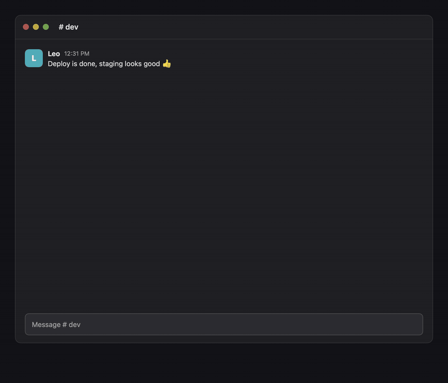

# Wingman

**Reply suggestions built on [Jev](https://typesafe.ai/blog/introducing-system-one-models-and-jev), TypeSafe's new System One decision model.**

A macOS menu-bar companion that reads the chat in front of you and suggests three replies. You pick one, Wingman types it into the message box, and you press Enter yourself. It never sends anything on its own.

Jev does the deciding and an LLM only does the writing. Jev does not write prose: it answers questions with fixed answers (what does this message want, does it need a reply, how soon, which way of replying fits) in about 0.3 s, with a probability for each answer. That split is why a suggestion takes seconds and costs about US$0.0002.

[繁體中文說明](README.zh-TW.md)



## How it works

Wingman splits the job between two kinds of model:

1. **Jev reads the message.** [TypeSafe's Jev](https://typesafe.ai/blog/introducing-system-one-models-and-jev) answers typed questions in about 0.3 s: what the other person wants, whether and how soon to reply, and which reply strategies fit.
2. **An LLM writes.** A model on OpenRouter (DeepSeek V4.1 Flash by default) writes one draft per strategy Jev picked. Drafts appear as they are written.
3. **Jev ranks.** Jev scores the three drafts and the best one gets ★. Enter types it; 1–3 types any of them.

## Supported apps

| App | How it is read | Permission |
|---|---|---|
| Slack | Accessibility tree (Electron DOM) | Accessibility |
| Discord | Accessibility tree (Electron DOM) | Accessibility |
| Messenger (web, in Chrome, Edge, Arc or Brave) | Accessibility tree, only on messenger.com or facebook.com/messages | Accessibility |
| Instagram (web, same browsers): messages, and replies under posts | Accessibility tree: instagram.com/direct, or the post whose reply box has your cursor | Accessibility |
| Threads (web, same browsers): messages, and replies under posts | Accessibility tree: threads.com/messages, or the post whose reply box has your cursor | Accessibility |
| LINE | Chat name and input box from accessibility; messages by on-device OCR | Accessibility, Screen & System Audio Recording |
| Telegram | On-device OCR | Accessibility, Screen & System Audio Recording |

Slack, Discord, Messenger, Instagram and Threads have been read on real chats. LINE and Telegram are read by OCR and have had less real-world use. In a browser, only the message pages of Messenger, Instagram and Threads are read, plus, on Instagram and Threads, the one post whose reply box your cursor is in: Wingman first asks the browser whether a text box has focus, and reads nothing further if not, so scrolling a feed or reading posts reads nothing. It then reads only that post (and the comment you are answering, when the box starts with @name), not the page. Every other site is not read. Replies under posts are written as public comments, and the panel says so. A photo, reel or shared post counts as a turn in the conversation (📎), so Wingman knows who spoke last.

## Privacy

- **There is no Wingman server.** Each person uses their own API keys, and the developer never receives keys or chats.
- **What is sent:** only the last 20 messages of the chat you are looking at, the chat's name, the senders' names and your own display name. Judgments go to TypeSafe, which commits not to train models on user data ([privacy policy](https://typesafe.ai/legal/privacy-policy)). Drafts are written through OpenRouter, which keeps prompts only if you opt in ([privacy](https://openrouter.ai/privacy)). Wingman asks OpenRouter to use only zero-data-retention providers that do not collect data, and skips the mainland China providers listed in `Brain.swift`.
- **When it is sent:** when a new message arrives in the chat you have open, or only when you press the shortcut if you turn off automatic analysis. Opening a chat or scrolling back sends nothing. Apps you untick in settings are never read.
- **What stays on your Mac:** keys, in the Keychain (this device only). Chats are never stored. Screen captures stay in memory and are read on the Mac. The log (`~/Library/Logs/Wingman.log`) holds times, counts and costs, never message text. Settings has a button that erases everything.
- **What Wingman can do to other apps:** type a draft you picked into the message box. It never presses Enter, strips anything that could act as Enter, checks that the chat is still the one the draft was written for, and checks that the message box has focus. If any of that fails, it copies the draft to the clipboard (this Mac only) instead.
- **Messages from other people go to the model as text.** A hostile message can try to steer the drafts, so read a draft before you send it. The model has no tools, keys or other chats to reach.

## Install

Requirements: macOS 14 or later, Xcode 16 or later, and `brew install opencc` (used at build time to generate Simplified Chinese).

```bash
git clone https://github.com/chyiiiiiiiiiiii/jev-wingman.git
cd jev-wingman
./scripts/install.sh
```

`install.sh` builds, signs the app with your first Apple Development certificate (or `WINGMAN_SIGN_IDENTITY`), copies it to `/Applications` and opens it. A stable signature keeps the Accessibility permission across rebuilds; without a certificate the app is signed ad hoc, and macOS asks for the permission again after each build.

On first launch Wingman walks through three steps: permissions, keys (an [OpenRouter key](https://openrouter.ai/keys) is required, a [TypeSafe key](https://console.typesafe.ai/keys) is optional and makes judgments a few seconds faster), and your display name.

## Use

- When a message arrives, **✦ 3 suggestions** appears above the message box. Press **⌥Space** (you can change the shortcut) or click it.
- **Enter** types the ★ draft, **1–3** types any draft, **Esc** closes. Check the text, then press Enter yourself.
- **Shorter, Softer, More formal, Warmer** rewrite the drafts. You can also type what you want to say, for example "tell them by Friday", and press Enter.
- **Sounds:** a soft sound when suggestions you are waiting for are ready, and when a reply is typed in. Analysis that finishes in the background stays silent. Settings has a switch and eight voices: Wood, Kalimba, Harp, Keys, Glass, Droplet, Bamboo and Tap; click one to hear it. They are synthesised by the app, play as system sound effects (at the alert volume, and not at all when interface sounds are off in System Settings), well under full volume.

A suggestion costs about US$0.0002 with the default models (one judgment, three drafts, one ranking).

The interface follows the system language: Traditional Chinese, Simplified Chinese, English, Japanese, Korean, Spanish, French and German. Any other language falls back to English. Drafts always follow the language of the chat.

## Development

```bash
swift test                                                         # parsers, decoders, safety rules
build/Wingman.app/Contents/MacOS/Wingman --render /tmp/wingman   # the panel, onboarding and settings as PNGs, the sounds as WAVs
/Applications/Wingman.app/Contents/MacOS/Wingman --dump --app instagram   # what a reader sees now (redacted)
/Applications/Wingman.app/Contents/MacOS/Wingman --probe com.hnc.Discord --wait   # an app's accessibility tree
OPENROUTER_API_KEY=… scripts/bench-writers.py                     # compare writer models on made-up threads
scripts/make-demo.py                                               # the GIFs at the top of the READMEs (needs ffmpeg)
```

- `Sources/WingmanCore`: pure logic with tests (Slack, Discord, Messenger, Instagram and Threads parsers, which web pages are read, OCR bubble parser, Jev and LLM decoders, language and safety rules, the sounds).
- `Sources/Wingman`: the app (readers, panels, settings, typing).
- Interface text goes through `L("…")`, keyed by its Traditional Chinese original. Add translations to `Resources/i18n/<language>.json`; `scripts/localize.py` runs during the build and stops it if a translation or placeholder is missing.

## Acknowledgements

- [jev-chat-jarvis](https://github.com/jev-chat/jev-chat-jarvis) and its [macOS version](https://github.com/jev-chat/jev-chat-jarvis-mac) (MIT) showed the approach: one reader per app, read text before pixels, fill but never send.
- [ChunUI](https://github.com/liseami/ChunUI) (MIT): the skeleton shimmer and reveal timings.
- [TypeSafe](https://typesafe.ai) for Jev, [OpenRouter](https://openrouter.ai) for model access, [OpenCC](https://github.com/BYVoid/OpenCC) for Simplified Chinese.

## License

[MIT](LICENSE)
