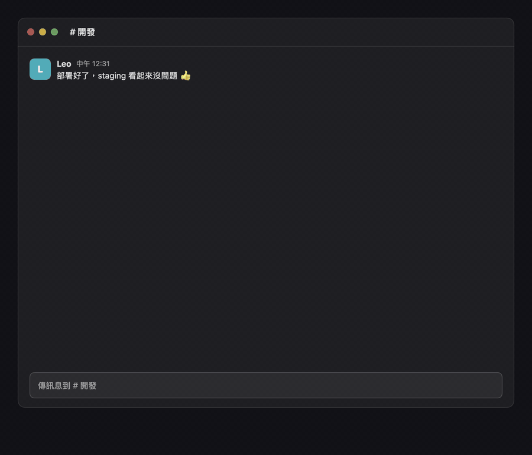

# Wingman

**建立在 [Jev](https://typesafe.ai/blog/introducing-system-one-models-and-jev) 上的回覆建議。Jev 是 TypeSafe 最新推出的 System One 決策模型。**

Wingman 是一個常駐在 macOS 選單列的小工具。它會讀你眼前的聊天，幫你想好 3 句回覆；你選一句，它幫你填進輸入框，最後由你自己按 Enter 送出。它不會自動送出任何訊息。

判斷交給 Jev，LLM 只負責寫字。Jev 不寫文章，而是在約 0.3 秒內回答有固定選項的問題，並給出每個答案的機率：這則訊息想要什麼、要不要回、多急、用哪種回法最合適。這樣分工，一次建議只要幾秒，花費大約 US$0.0002。

[English](README.md)



## 運作方式

Wingman 把工作分給兩種模型：

1. **Jev 判斷訊息**：[TypeSafe 的 Jev](https://typesafe.ai/blog/introducing-system-one-models-and-jev) 大約 0.3 秒就能回答幾個固定格式的問題：對方想要什麼、需不需要回、多急，以及適合用哪幾種回法。
2. **LLM 寫回覆**：透過 OpenRouter 呼叫模型（預設是 DeepSeek V4.1 Flash），照 Jev 挑的回法各寫一句，寫好一句就先顯示一句。
3. **Jev 評分**：Jev 幫 3 句打分數，最推薦的那句標 ★。按 Enter 填入 ★ 那句，按 1–3 可以自己選。

## 支援的 App

| App | 讀取方式 | 需要的權限 |
|---|---|---|
| Slack | 輔助使用（直接讀網頁結構） | 輔助使用 |
| Discord | 輔助使用（直接讀網頁結構） | 輔助使用 |
| Messenger 網頁版（Chrome、Edge、Arc、Brave） | 輔助使用，只讀 messenger.com 或 facebook.com/messages | 輔助使用 |
| Instagram 網頁版私訊（同上瀏覽器） | 輔助使用，只讀 instagram.com/direct | 輔助使用 |
| Threads 網頁版私訊（同上瀏覽器） | 輔助使用，只讀 threads.com/messages | 輔助使用 |
| LINE | 聊天室名稱和輸入框用輔助使用讀；訊息內容在本機截圖辨識 | 輔助使用、螢幕與系統錄音 |
| Telegram | 在本機截圖辨識 | 輔助使用、螢幕與系統錄音 |

Slack、Discord、Messenger、Instagram、Threads 都已經在真實聊天中讀過。LINE 和 Telegram 是靠截圖辨識，實際使用的次數還比較少。瀏覽器裡只讀 Messenger、Instagram、Threads 的訊息頁，動態、個人檔案、貼文和其他網站都不讀。對話裡的照片、Reels 或分享的貼文會算成一則（📎），這樣 Wingman 才知道最後是誰說話。

## 隱私

- **Wingman 沒有伺服器。** 每個人用自己的 API key，開發者收不到任何人的 key，也收不到聊天內容。
- **會送出什麼：** 只有你正在看的對話裡最近 20 則訊息、聊天室名稱、發言人名字，以及你自己的顯示名稱。
  - 判斷送到 TypeSafe，它承諾不拿使用者資料訓練模型（[隱私政策](https://typesafe.ai/legal/privacy-policy)）。
  - 寫回覆透過 OpenRouter。OpenRouter 只有在你主動開啟時才會保存內容（[隱私說明](https://openrouter.ai/privacy)）。Wingman 會要求它只轉給「零資料保留、不收集資料」的供應商，並排除 `Brain.swift` 裡列出的中國大陸供應商。
- **什麼時候送出：** 你開著的聊天室有新訊息進來時才送；關掉自動分析的話，就只在你按快捷鍵時送。打開聊天室、往上捲動都不會送出。在設定裡取消勾選的 App，Wingman 完全不會讀。
- **留在你 Mac 上的東西：**
  - key 存在鑰匙圈，而且只存在這台裝置。
  - 聊天內容從來不會存下來。截圖只在記憶體裡、在本機辨識。
  - 紀錄檔（`~/Library/Logs/Wingman.log`）只記時間、次數和花費，不記任何訊息內容。
  - 設定裡有「清除所有資料」按鈕。
- **Wingman 能對其他 App 做什麼：** 只能把你選的回覆打進輸入框。它不會按 Enter，也會先濾掉任何可能被當成 Enter 的字元；打字前會確認聊天室還是寫草稿時的那一個、游標在輸入框裡。任何一項不符合，就改成只複製到剪貼簿，而且只留在這台 Mac。
- **別人的訊息會原文送給模型。** 有心人可能在訊息裡寫指令來影響建議，所以送出前請看一下內容。模型沒有任何工具可用，也拿不到 key 或其他聊天室。

## 安裝

需求：macOS 14 以上、Xcode 16 以上，以及 `brew install opencc`（建置時用來產生簡體中文）。

```bash
git clone https://github.com/chyiiiiiiiiiiii/jev-wingman.git
cd jev-wingman
./scripts/install.sh
```

`install.sh` 會建置 App，用你的第一張 Apple Development 憑證簽名（或用 `WINGMAN_SIGN_IDENTITY` 指定），複製到「應用程式」資料夾並打開。簽名固定的話，重新建置後「輔助使用」權限還會在；沒有憑證的話會改用臨時簽名，每次重新建置後 macOS 都會再要你開一次權限。

第一次打開時，Wingman 會帶你走三步：開權限、填 key（必須有 [OpenRouter key](https://openrouter.ai/keys)；[TypeSafe key](https://console.typesafe.ai/keys) 選填，填了判斷會快幾秒），最後填你的顯示名稱。

## 使用

- 訊息進來時，輸入框上方會出現「**✦ 3 個建議**」。按 **⌥Space**（可以在設定裡改）或直接點它。
- **Enter** 填入 ★ 那句，**1–3** 選一句，**Esc** 關閉。填入後看一下內容，再自己按 Enter 送出。
- 按「更短」「更委婉」「更正式」「更熱情」可以重寫；也可以直接打你想說的意思，例如「跟他說週五前給」，按 Enter 重寫。
- **音效**：你在等的建議寫好時，和回覆填進輸入框時，會輕輕響一聲；背景自動分析完成時不會出聲。設定裡可以關掉，也可以從「木質」「拇指琴」「豎琴」「電鋼琴」「玻璃」「水滴」「竹筒」「輕觸」八種音色中挑一種，點一下就能試聽。聲音由 App 自己合成，走系統音效：音量跟著提示音音量，系統關掉介面音效時也不會響，而且遠低於最大值。

用預設的模型，每次建議（判斷一次、寫 3 句、評分一次）大約 US$0.0002。

介面語言跟著系統語言：繁體中文、簡體中文、英文、日文、韓文、西班牙文、法文、德文。其他語言顯示英文。建議回覆本身一律跟著對話的語言。

## 開發

```bash
swift test                                                         # 解析、解碼與安全規則的測試
build/Wingman.app/Contents/MacOS/Wingman --render /tmp/wingman   # 把面板、引導和設定畫成 PNG，音效存成 WAV
/Applications/Wingman.app/Contents/MacOS/Wingman --dump --app instagram   # 現在讀到了什麼（文字會遮掉）
/Applications/Wingman.app/Contents/MacOS/Wingman --probe com.hnc.Discord --wait   # 看某個 App 的畫面結構
OPENROUTER_API_KEY=… scripts/bench-writers.py                     # 用虛構對話比較寫回覆的模型
scripts/make-demo.py                                               # 產生 README 最上面的 GIF（需要 ffmpeg）
```

- `Sources/WingmanCore`：純邏輯，都有測試（Slack、Discord、Messenger、Instagram、Threads 的解析、哪些網頁可以讀、截圖辨識的氣泡分析、Jev 與 LLM 回應的解碼、語言與安全規則、音效）。
- `Sources/Wingman`：App 本身（讀取、面板、設定、填入）。
- 介面文字一律包在 `L("…")` 裡，以繁中原文當作查詢的鑰匙。翻譯寫在 `Resources/i18n/<語言>.json`；建置時會跑 `scripts/localize.py`，缺翻譯或格式符號對不上就停止建置。

## 致謝

- [jev-chat-jarvis](https://github.com/jev-chat/jev-chat-jarvis) 和它的 [macOS 版](https://github.com/jev-chat/jev-chat-jarvis-mac)（MIT）：「每個 App 一個讀取模組、先讀文字再截圖、只填入不送出」這套做法來自它們。
- [ChunUI](https://github.com/liseami/ChunUI)（MIT）：骨架掃光和出場動畫的數值。
- [TypeSafe](https://typesafe.ai) 的 Jev、[OpenRouter](https://openrouter.ai) 的模型服務、[OpenCC](https://github.com/BYVoid/OpenCC) 的簡體轉換。

## 授權

[MIT](LICENSE)
